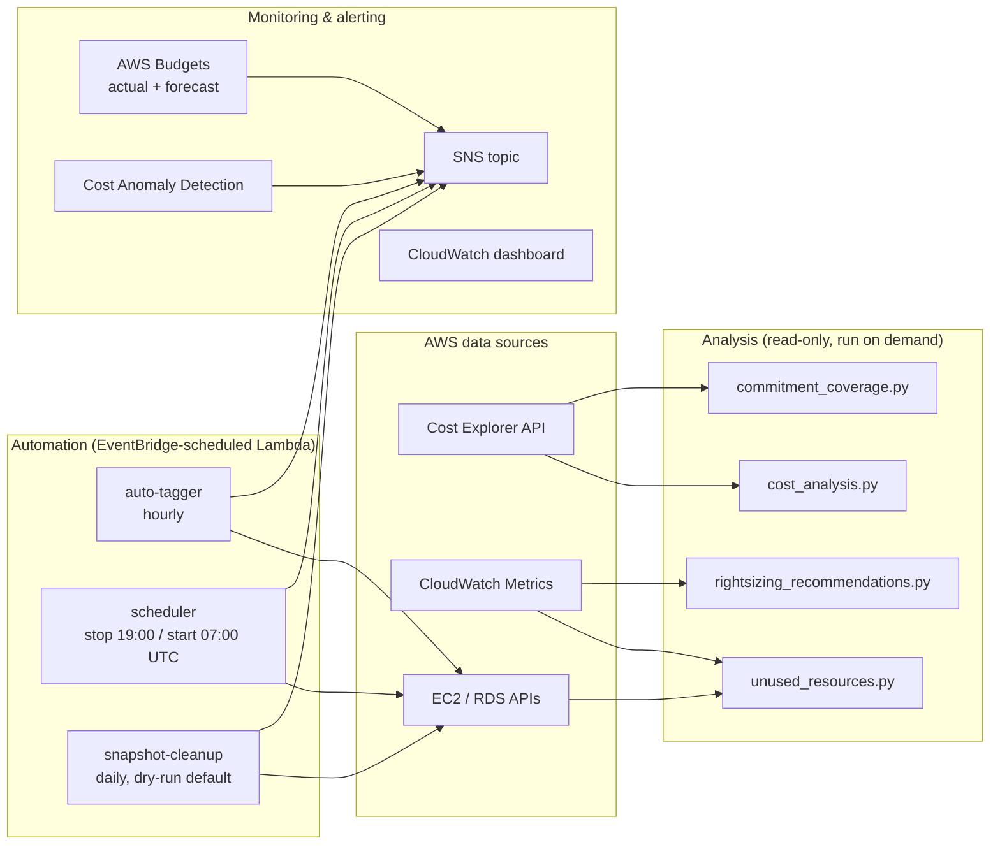

# AWS FinOps Cost Optimizer

[](https://github.com/metafive-ai/aws-finops-cost-optimizer/actions/workflows/ci.yml)
[](https://www.terraform.io/)
[](https://www.python.org/)
[](LICENSE)
[](https://github.com/metafive-ai/aws-finops-cost-optimizer/commits/master)
[](https://github.com/metafive-ai/aws-finops-cost-optimizer/stargazers)

A practical AWS FinOps toolkit covering the three pillars of cost optimization:

1. **Visibility** — where the money goes (Cost Explorer reports, CloudWatch dashboard, anomaly detection)
2. **Usage optimization** — stop paying for waste (idle/unattached resource detection with dollar estimates, scheduling, snapshot lifecycle)
3. **Rate optimization** — pay less for what you keep (Savings Plans / Reserved Instance utilization and coverage analysis)

Analysis is read-only Python; remediation is automated through Lambda with deliberately conservative defaults (dry-run first, opt-in tags, human review for anything destructive). Everything deploys with Terraform.

---

## Who is this for?

- **Platform / cloud engineers** who want concrete, working FinOps automation rather than slideware
- **Engineering leaders** evaluating what AI-augmented infrastructure delivery looks like with real guardrails
- **Anyone running AWS** who suspects they're paying for idle resources (you probably are — run `unused_resources.py` and see)

Every finding carries a dollar estimate where honestly estimable, so you can prioritize by impact instead of drowning in lists.

---

## Architecture



**Design principles:**

- **Findings are recommendations, not actions.** Analysis scripts never modify anything; each finding carries an estimated monthly saving (where honestly estimable) so remediation can be prioritized by impact.
- **Destructive automation is opt-in and reversible-first.** Snapshot cleanup ships in dry-run mode; the scheduler only touches instances explicitly tagged `AutoScheduler=enabled`; the auto-tagger fills missing tags but never overwrites existing values; snapshots tagged `Retain` are never deleted.
- **Least privilege.** The Lambda role grants exactly the actions the three functions perform — no wildcard service access.

---

## Repository layout

```
├── scripts/                      # Read-only analysis (run locally or in CI)
│   ├── cost_analysis.py          # Cost Explorer reports by service/region/type
│   ├── unused_resources.py       # Waste detection with $ estimates
│   ├── rightsizing_recommendations.py  # EC2 CPU+memory utilization analysis
│   └── commitment_coverage.py    # Savings Plans / RI utilization & coverage
├── web/                          # Local stdlib-only dashboard over those scripts
│   ├── app.py                    # Routes + HTTP server (no third-party framework)
│   ├── data.py                   # Demo/live payloads, per-section failure reporting
│   ├── demo_data.py              # Sample figures, labelled as not live billing
│   ├── live.py                   # Read-only Cost Explorer queries behind live mode
│   ├── reports.py                # CSV/JSON writers matching the CLI export format
│   ├── templates/index.html      # Dashboard shell
│   └── static/                   # styles.css + app.js
├── lambda/                       # Scheduled automation
│   ├── auto_tagger/              # Enforce cost-allocation tags (hourly)
│   ├── scheduler/                # Stop/start EC2 outside business hours
│   └── snapshot_cleanup/         # EBS snapshot retention (dry-run default)
├── terraform/                    # Full IaC deployment (root + lambda module)
├── dashboards/                   # CloudWatch cost overview dashboard
├── tests/                        # Unit tests for scripts and Lambdas
└── docs/                         # Architecture, deployment, troubleshooting
```

---

## Quick start — analysis only (no deployment needed)

```bash
git clone https://github.com/metafive-ai/aws-finops-cost-optimizer.git
cd aws-finops-cost-optimizer
pip install -r scripts/requirements.txt

# Where does the money go? (last 30 days, by service)
python scripts/cost_analysis.py --days 30 --group-by SERVICE --output report.csv

# Same report from labelled sample data — no AWS credentials, no Cost Explorer call
python scripts/cost_analysis.py --demo --output demo_report.csv

# What is being wasted? (idle EC2/RDS, unattached EBS, unused EIPs, old snapshots)
python scripts/unused_resources.py --region eu-west-1 --output unused.json

# What is over-provisioned? (CPU always, memory when the CloudWatch Agent reports it)
python scripts/rightsizing_recommendations.py --region eu-west-1 --output recs.json

# Are commitments working? (Savings Plans / RI utilization and coverage)
python scripts/commitment_coverage.py --days 30 --output commitments.json
```

Requires AWS credentials with read access (`ce:Get*`, `ec2:Describe*`, `rds:Describe*`, `cloudwatch:GetMetricStatistics`, `sts:GetCallerIdentity`). Cost Explorer must be enabled once per account (24h backfill delay on first activation). `cost_analysis.py --demo` is the exception: it renders labelled sample data and makes no AWS call, so the report format can be shown without credentials.

### Example: unused_resources.py output

```json
{
  "Summary": {
    "TotalFindings": 14,
    "FindingsByType": {"UnattachedEBSVolumes": 6, "UnusedElasticIPs": 3, "...": "..."},
    "EstimatedMonthlySavingsUSD": 187.40,
    "UnquantifiedFindings": 2,
    "PricingAssumptions": "us-east-1 on-demand list prices; snapshots costed at full volume size (upper bound). ..."
  },
  "UnattachedEBSVolumes": [
    {
      "VolumeId": "vol-0abc...",
      "VolumeType": "gp2",
      "SizeGiB": 500,
      "Finding": "Unattached EBS Volume",
      "EstimatedMonthlySavingsUSD": 50.0,
      "Recommendation": "Snapshot then delete the volume, or reattach it"
    }
  ]
}
```

Savings estimates are intentionally conservative and clearly labeled: stable unit prices (EBS GB-month, Elastic IP hours, snapshot storage) are quantified; compute savings that depend on instance pricing are flagged but left for validation with the resource owner rather than guessed.

---

## Web dashboard (presentations, no PowerShell required)

`web/` is a local, read-only UI over the same four analysis scripts, so a cost review can be
run in a browser instead of a terminal. It uses Python's standard library HTTP server only —
**no Flask, no Node, no new package to install** — which keeps it working on a laptop with no
network and keeps CI unchanged.

### PowerShell — demo mode (works offline, no AWS credentials)

```powershell
cd D:\aws-finops-cost-optimizer
py -3.11 -m venv .venv
.\.venv\Scripts\Activate.ps1
pip install -r scripts/requirements.txt          # boto3 only; already required by scripts/
pip install -r requirements-dev.txt              # pytest / flake8 / mypy / bandit
python -m web.app                                # http://127.0.0.1:8080
```

Open `http://127.0.0.1:8080`. The dashboard starts on **Demo**, every figure is stamped
`DEMO DATA — NOT LIVE AWS BILLING`, and no AWS API is called — that guarantee is covered by
`tests/test_web.py::TestDemoPayload::test_demo_request_makes_no_aws_calls`.

Handy variants:

```powershell
python -m web.app --port 9000     # different port
python -m web.app --demo-only     # refuse mode=live; sample data only
python -m web.app --help
```

### Live mode (optional, read-only)

Switch the **Data source** control to **Live**. Spend comes from Cost Explorer through
`web/live.py`, which calls `ce:GetCostAndUsage` and nothing else; waste, right-sizing and
commitments come from the same `unused_resources.py`, `rightsizing_recommendations.py` and
`commitment_coverage.py` classes the CLI uses. Live mode needs usable AWS credentials for the
process the server runs in and never writes to AWS.

What the live layer does with the date filter:

- **7d and 30d** query `DAILY` granularity, so the trend chart is one bar per complete day;
  **90d** queries `MONTHLY`, one bar per calendar month touched (the first and last are partial).
- Cost Explorer's `TimePeriod.End` is **exclusive**. The request sends today, and the payload
  labels the window with the last day it can actually contain, so a live report never claims to
  cover a day AWS has not billed yet. The period and its note are in `meta.period`.
- Amounts keep their sign, so credits appear as negative lines (and can push another service
  above 100% of a small net total); a window whose net spend is zero or negative is labelled
  rather than drawn as a donut.
- A window that bills **under a cent per service is a correct answer, not an outage**. `meta.status`
  carries the distinction (`connected`, `connected-zero`, `connected-empty`, `partial`,
  `unavailable`) and the page says "Live AWS data connected — no material spend in this period"
  instead of leaving a $0.00 account looking broken. A flat-zero trend draws its zero line and
  labels each period; it never invents an axis scale to fill the panel.

Run it against your own account:

```powershell
cd D:\aws-finops-cost-optimizer
.\.venv\Scripts\Activate.ps1        # the repo venv - see the credential note below
python -m web.app
# then open http://127.0.0.1:8080 and choose Live, or:
Invoke-RestMethod "http://127.0.0.1:8080/api/dashboard?days=7&mode=live" | ConvertTo-Json -Depth 6
```

Live requests are several sequential AWS scans, so the first response takes tens of seconds; the
page says so in its status line instead of looking frozen.

If Cost Explorer is unreachable, the dashboard does **not** print sample numbers as if they were
real: each failed section returns an empty list plus an entry in `errors[]` naming the section,
the AWS error `Code`, the message and a hint, and `/api/dashboard` answers `207 Multi-Status` —
including when only some sections failed, so a partly-readable report is never served as a clean
`200`. A common cause is running the
server from the wrong virtualenv: botocore raises `MissingDependencyException` when the CRT
package is absent, so live mode must run from the repo `.venv` that
`pip install -r scripts/requirements.txt` created. The health probe (`/api/health`) reports
credential resolution only and marks Cost Explorer as
`unverified (no AWS call is made by the dashboard health probe)` — it will not claim
connectivity it has not tested.

### EBS volume status (live, read-only)

The **EBS volumes** view lists every volume in the regions you name, with what AWS itself says
about each one: Volume ID, volume state, attachment state, the attached instance if there is one,
availability zone, size in GiB and region. It is served by `/api/ebs` and collected by
`web/ebs.py`, which calls `ec2:DescribeVolumes` through a regional paginator and **nothing else** —
`tests/test_ebs.py::TestEbsAccess::test_only_describe_volumes_is_called` and
`test_no_status_filter_is_sent` pin both halves of that guarantee.

How the attachment column is decided, and why it is never guessed:

| AWS returns | The table says | Why |
|---|---|---|
| `State: available`, no attachments | **Detached** | That is EC2's own definition of an unattached volume |
| an attachment in `attached` state | **Attached** | Multi-attach shows the attached instance first, plus `(+n more)` |
| `attaching` / `detaching` | Attaching / Detaching | A transition is not the same fact as a completed attach |
| `creating`, `deleting`, `deleted`, `error`, `optimizing` | Not attached: Creating / Deleting / … | Each is its own state; calling a creating volume "detached" would be a claim AWS did not make |
| `in-use` with an empty attachment list | In use, but no attachment was returned | A real inconsistency in the response, shown as one |
| a state this project has never seen | Not attached: <that state> | Unknown states are named, never sorted into Attached/Detached |

Refreshing: the **Refresh volumes** button reads on demand, and the panel re-reads every 60 seconds
while the tab is visible (a hidden tab spends no AWS calls). The status line ends with
`Last refreshed <UTC time>` from the successful response. A poll that fails keeps the previous real
rows on screen and says `Refresh failed: … Showing the volume list from <time>` — never an empty
table, and never sample rows. Switching the data source or editing the region list clears the table
before re-reading, so demo rows cannot sit under a live selection.

Errors are per region and stay visible: a region that cannot be queried produces one `errors[]`
entry naming it, while the regions that answered keep their real rows (`207 Multi-Status`,
`meta.status.State = partial`). If no region answers, the state is `unavailable` and the table is
empty with a reason — this feature has no fallback data at all, so a credential, permission or API
failure can only ever read as a failure. An account with no volumes is reported separately as
"connected — AWS returned no volumes", because that is a different fact.

**IAM: one read-only action.** The dashboard needs `ec2:DescribeVolumes` and no write permission of
any kind. `DescribeVolumes` is a describe-only API with no resource-level permissions, so `Resource`
has to be `"*"`; what *can* be narrowed is where the identity may look. Attach this to the IAM user
or role behind the AWS profile the server runs with:

```json
{
  "Version": "2012-10-17",
  "Statement": [
    {
      "Sid": "DashboardVolumeStatusReadOnly",
      "Effect": "Allow",
      "Action": ["ec2:DescribeVolumes"],
      "Resource": "*",
      "Condition": {
        "StringEquals": { "aws:RequestedRegion": ["us-east-1", "eu-west-1"] }
      }
    }
  ]
}
```

`aws:RequestedRegion` is an AWS global condition key; `ec2:Region` is the EC2-specific equivalent and
both work in an identity-based policy. Drop the `Condition` only if you want the panel to be able to
read volume metadata in every region the account uses.

Nothing here needs `ec2:AttachVolume`, `ec2:DetachVolume`, `ec2:DeleteVolume` or
`ec2:ModifyVolume`; if the panel's hint tells you `ec2:DescribeVolumes` is missing, add exactly that
action or keep presenting in Demo mode.

### What the UI shows

| Area | Contents |
|---|---|
| Overview | Total spend (with the billing currency), monthly run rate, top service, waste findings, estimated monthly savings; spend trend and service donut |
| Cost breakdown | Service + region tables with percentages, region bars |
| Optimization | Idle EC2/EBS/EIP/snapshot/RDS findings with dollar estimates; right-sizing recommendations |
| EBS volumes | Every volume in the regions you name: state, attachment, instance, zone, size in GiB, region — refreshed on demand and every 60s, with the last successful read shown |
| Commitments | Savings Plans and RI utilization/coverage cards with the analyzer's own observations |
| Reports | CSV and JSON download of the current mode and period, plus a CSV preview |

Banners: a green "live connected" banner only when `mode=live` and `errors` is empty; a red
unavailable/partial banner whenever any live section failed; the amber demo banner whenever the
figures on screen are samples. A hidden request failure keeps the previous response on screen but
labels the banner as a failed request, because the page can no longer describe those numbers.

Filters: 7 / 30 / 90 days. Any other value falls back to 30 rather than silently changing the
billing window.

Endpoints: `/` (shell), `/static/*` (allowlisted assets only), `/api/health`, `/api/dashboard`,
`/api/ebs`, `/api/report/csv`, `/api/report/json`. The server binds `127.0.0.1` by default, sends a
`Content-Security-Policy` that permits no inline script, and never exposes credentials, profile
names or file paths.

---

## Deployment (automation + guardrails)

```bash
cd terraform
cp terraform.tfvars.example terraform.tfvars   # edit: owner_email, alert_email, budget
terraform init
terraform plan
terraform apply
```

This deploys:

| Component | Default behavior | Safety |
|---|---|---|
| Auto-tagger Lambda | Hourly; adds missing `Environment`/`Owner`/`CostCenter` tags | Never overwrites existing tag values |
| EC2 scheduler Lambda | Stop 19:00 / start 07:00 UTC, weekdays | Only instances tagged `AutoScheduler=enabled` |
| Snapshot cleanup Lambda | Daily; snapshots older than 30 days | **Dry-run by default**; `Retain` tag always wins |
| AWS Budget | Alerts at 80%/100% actual + 100% forecasted | Email sent by AWS Budgets directly (not via SNS) |
| Cost Anomaly Detection | Per-service ML monitor, daily digest | Alerts only above `anomaly_threshold_usd` |
| S3 report bucket | Encrypted, versioned, public access blocked | Reports auto-expire (the cost tool shouldn't hoard storage) |

Import the CloudWatch dashboard (billing metrics live in us-east-1; the path is relative to the `terraform/` directory the deployment block above ran in):

```bash
aws cloudwatch put-dashboard --dashboard-name FinOps-Overview \
  --dashboard-body file://../dashboards/cost_overview_dashboard.json --region us-east-1
```

If you deploy to a region other than us-east-1, edit the two Lambda widgets' `region` in the dashboard JSON first — Lambda metrics live in the deployment region, unlike billing metrics.

Full walkthrough: [docs/DEPLOYMENT.md](docs/DEPLOYMENT.md) · Common issues: [docs/TROUBLESHOOTING.md](docs/TROUBLESHOOTING.md)

---

## What it costs to run

| Service | Typical usage | Estimated cost |
|---|---|---|
| Cost Explorer API | a few hundred requests/month | ~$2–3 ($0.01/request) |
| Lambda | ~800 invocations/month, seconds each | ~$0 (free tier) |
| CloudWatch Logs + dashboard | 30-day retention, 1 dashboard | ~$0–3 (first 3 dashboards free) |
| SNS, EventBridge, Budgets | first 2 budgets free | ~$0 |

A single unattached 100 GB gp3 volume ($8/month) or one forgotten `m5.xlarge` (~$140/month on-demand) pays for the toolkit many times over — but measure your own savings with the reports rather than trusting anyone's ROI claim, including this one.

---

## Testing & code quality

CI runs on every push and pull request ([ci.yml](.github/workflows/ci.yml)):

- **flake8** lint over `scripts/`, `lambda/`, and `tests/`
- **mypy** type checking over `scripts/`
- **pytest** — 290 unit tests covering the analysis scripts, all three Lambda handlers, the
  dashboard layer and the EBS volume panel (AWS calls mocked; no account needed)
- **bandit** SAST scan (medium+ severity fails the build)
- **terraform validate** and **terraform fmt -check** over the full configuration

```bash
pip install -r requirements-dev.txt
pytest tests/ -v --cov=scripts --cov=lambda
```

`web/` is linted, type-checked and scanned the same way; CI does not yet list it in its path
filters, so run these locally before touching the dashboard:

```powershell
python -m flake8 web/ tests/ scripts/ lambda/ --max-line-length=120 --extend-ignore=E203
$env:MYPYPATH = "scripts"; python -m mypy web/ scripts/ --ignore-missing-imports --no-strict-optional
python -m bandit -q -r web/ -ll
```

---

## Documentation

- [ARCHITECTURE.md](docs/ARCHITECTURE.md) — components, data flow, design decisions
- [DEPLOYMENT.md](docs/DEPLOYMENT.md) — step-by-step Terraform deployment
- [TROUBLESHOOTING.md](docs/TROUBLESHOOTING.md) — common errors and fixes
- [CONTRIBUTING.md](CONTRIBUTING.md) — how to contribute

---

## How this was built

Specified and directed by Mohamed Ben Lakhoua; built by AI coding agents against those specifications — not hand-written. I review and validate every change before it merges. The judgment calls are the human part: what to automate versus only report, which defaults are safe enough to ship enabled, and where a dollar estimate is honest versus misleading. CI enforces the floor: lint, types, tests, SAST, and Terraform validation on every change.

**Disclaimer:** educational/portfolio project. Thresholds, schedules, and retention policies are examples — align them with your organization's policies before production use. No employer-specific content is included.

---

## Contact

**Author:** Mohamed Ben Lakhoua  
**Org:** [github.com/metafive-ai](https://github.com/metafive-ai)  
**LinkedIn:** [linkedin.com/in/benlakhoua](https://linkedin.com/in/benlakhoua)  
**Email:** [mo@metafive.ai](mailto:mo@metafive.ai)

---

⭐ **Found a saving with this toolkit?** A star helps other engineers find it — and issues/PRs with your own findings are very welcome.

*Last updated: August 2026*
