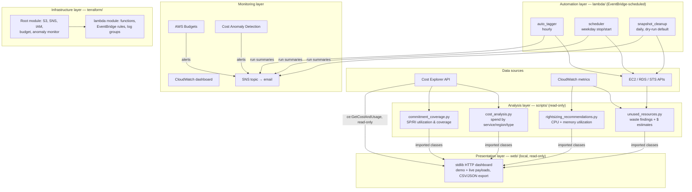

# AWS FinOps Cost Optimizer — Architecture

This document describes the system architecture, components, and data flow of the toolkit, and the reasoning behind the main design decisions.

## Guiding principles

- **Analysis and action are separated.** Scripts read and report; only the Lambda functions modify resources, each within a narrow, tag-scoped contract.
- **Conservative by default.** Anything destructive starts in dry-run or opt-in mode. A cost tool that deletes the wrong resource costs more trust than it ever saves in dollars.
- **Least privilege.** The Lambda execution role lists exactly the actions the three functions perform.
- **Cheap to run.** The toolkit's own footprint (Lambda invocations, Cost Explorer API calls, one dashboard) is a few dollars a month.

## System components

### 1. Analysis layer (`scripts/`)

Read-only Python scripts run on demand (locally, from CI, or any scheduled runner):

| Script | Question it answers | Key sources |
|---|---|---|
| `cost_analysis.py` | Where does the money go? | Cost Explorer `GetCostAndUsage` (paginated, aggregated across periods); `--demo` uses labelled sample data and calls no AWS API |
| `unused_resources.py` | What are we paying for that nothing uses? | EC2/RDS describes + CloudWatch utilization |
| `rightsizing_recommendations.py` | What is over-provisioned? | CloudWatch CPU (always) + CWAgent memory (when installed) |
| `commitment_coverage.py` | Are Savings Plans / RIs earning their keep? | Cost Explorer utilization & coverage APIs |

Waste findings carry `EstimatedMonthlySavingsUSD` where a stable unit price exists (EBS GB-month, Elastic IP, snapshot storage); compute savings are deliberately left unquantified with a pointer to how to measure them, rather than guessed from a stale price table.

### 2. Automation layer (`lambda/`)

Three single-purpose Lambda functions, each triggered by EventBridge rules and each publishing an optional SNS run summary:

- **auto_tagger** (hourly): adds missing `Environment` / `Owner` / `CostCenter` tags to EC2 instances and EBS volumes so cost allocation reports stay usable. Never overwrites an existing tag value; a failure on one resource doesn't abort the run.
- **scheduler** (weekday cron pair): two rules invoke the same function with `{"action": "stop"}` in the evening and `{"action": "start"}` in the morning. Only instances tagged `AutoScheduler=enabled` participate — the tag marks membership, the event decides the action, so an instance is stopped at night and started again in the morning by the same contract.
- **snapshot_cleanup** (daily): deletes snapshots older than the retention period, except those tagged `Retain`. Ships with `DRY_RUN=true`; the operator flips it only after reviewing dry-run reports. Snapshots backing registered AMIs fail deletion with `InvalidSnapshot.InUse` and are skipped, not fatal.

### 3. Monitoring layer

- **AWS Budgets** — alerts at 80% and 100% of actual spend plus 100% of *forecasted* spend, so the warning arrives before the money is gone.
- **Cost Anomaly Detection** — per-service ML monitor with a daily digest, alerting only above a configurable dollar impact to avoid noise.
- **CloudWatch dashboard** (`dashboards/cost_overview_dashboard.json`) — estimated charges total and by service, plus invocation/error widgets for the three optimizer Lambdas (a failed optimizer run means a savings action silently didn't happen — that must be visible).
- **SNS topic** — carries the automation run summaries published by the three Lambdas. Budget and anomaly alerts do **not** route through it: AWS Budgets and Cost Anomaly Detection send their own emails straight to `alert_email`, so the same inbox receives all three, by two different mechanisms.

### 4. Infrastructure layer (`terraform/`)

- Root module: S3 report bucket (encrypted, versioned, public-access-blocked, lifecycle-expired), SNS topic, least-privilege IAM role, budget, anomaly monitor + subscription.
- `modules/lambda`: packages each function directory with `archive_file`, deploys the functions, EventBridge rules/targets/permissions, and per-function log groups with retention.
- Lambda environment intentionally does **not** set `AWS_REGION` — it is a reserved variable the runtime provides; setting it fails deployment.
- The budget uses a fixed `time_period_start` rather than `timestamp()` to avoid a perpetual plan diff.

### 5. Presentation layer (`web/`)

A local dashboard over the four analysis classes, for reviews and demos. It imports the
existing modules instead of re-implementing them: `UnusedResourceFinder`,
`RightSizingRecommender` and `CommitmentAnalyzer` produce the live waste, right-sizing and
commitment sections, `web/live.py` queries Cost Explorer directly for the spend sections, and
demo mode reuses `demo_cost_records()` / `calculate_percentage()` / `build_summary()` for the
sample payload.

| File | Responsibility |
|---|---|
| `web/app.py` | Query-parameter validation, routing in a plain `dispatch()`, and the `ThreadingHTTPServer` adapter |
| `web/data.py` | One payload shape for both modes; live failures become per-section `errors[]` entries |
| `web/demo_data.py` | Sample regions, trend, waste and right-sizing records, all carrying the demo label |
| `web/live.py` | Read-only `ce:GetCostAndUsage` access: window arithmetic, granularity, pagination, typed errors |
| `web/ebs.py` | Read-only `ec2:DescribeVolumes` per region: volume/attachment labels, per-region failures, refresh timestamp |
| `web/reports.py` | CSV/JSON writers that follow the CLI's fieldname rules |
| `web/templates`, `web/static` | HTML shell, stylesheet and vanilla JS controller (no build step) |

**Why live spend does not go through `CostAnalyzer`:** the CLI scripts answer a failed query with
`sys.exit(1)`, which is right in a terminal and wrong in a request handler — the dashboard needs
the API's error *code* to tell "this identity cannot call Cost Explorer" apart from "this account
has no Cost Explorer data yet". The CLI also fixes `MONTHLY` granularity, so a 7-day filter would
return one bar, and `TimePeriod.End` is exclusive, so the range the data covers is not the range
that was asked for. `web/live.py` keeps the record fields `analyze_costs()` produces, so
percentage maths, totals, CSV/JSON export and the UI stay shared between modes.

**Why volume status is a separate endpoint:** `web/ebs.py` reads `ec2:DescribeVolumes`, which
answers in about a second, while `/api/dashboard` runs several sequential Cost Explorer scans that
take tens of seconds. A volume table that refreshes every minute cannot afford to re-bill the
account on each tick, and billing data does not change minute to minute — so the panel polls
`/api/ebs` alone, and `live_payload()` keeps its existing shape (no `volumes` key) so the charts,
CSV/JSON export and the existing tests are untouched.

**Why the attachment column is derived, not inferred:** EC2 reports volume state and attachment
state separately, and they mean different things. `available` with no attachment list is what AWS
calls a detached volume; `attaching` and `detaching` are transitions, not facts about the past; and
`creating`, `deleting`, `deleted`, `error` and `optimizing` are states of their own, so labelling any
of them "Detached" would claim a fact AWS did not state. `web/ebs.py::attachment_label` therefore has
an explicit branch per documented value and keeps the raw AWS text for anything it does not know,
which is why a future EC2 state reads as itself instead of being sorted into the nearest familiar
pair. Multi-attach volumes list several instances; the row names the attachment whose state produced
the label and counts the rest.

**Why the standard library rather than Flask:** the repo installs `boto3` only, and the
dashboard's job is to demo the project on a laptop, often offline. A stdlib server adds no
dependency, no install step and no CI surface, and `dispatch()` is framework-neutral, so a Flask
wrapper would be a thin shim rather than a rewrite. Flask is deliberately *not* added to
`requirements.txt`.

**Demo/live separation is enforced structurally, not by a banner.** `build_payload()` chooses one
mode and carries it in `meta`; a live section that fails returns an empty list plus an error
message (`/api/dashboard` answers `207`), so there is no code path that substitutes a sample
figure into a live report. Every demo record keeps a `Source` label through into CSV and JSON
exports.

**The window the data covers is stated, not implied.** `live.window()` returns the requested range
and the range Cost Explorer can answer for, because its `End` is exclusive: a 7-day filter billed
through yesterday sends today and labels yesterday. Granularity follows the chart — `DAILY` up to
31 days, `MONTHLY` beyond — and demo mode walks the same `period_buckets()`, so the sample chart
has the shape a real one would for that filter. Credits keep their sign through aggregation, an
empty `ResultsByTime` is served as "no spend recorded" with no error, and the estimate flags the
API returns are shown on the chart rather than smoothed away.

**Whether live data arrived is decided in the data layer, not by the chart.** A sub-cent account
renders as `$0.00` everywhere, which the browser cannot tell apart from a query that never ran, so
`data.status_for()` derives `meta.status` from the errors list, the returned rows and the window
total (`connected`, `connected-zero`, `connected-empty`, `partial`, `unavailable`, or `demo`). The
UI only reads that field for its green banner, so an all-zero account is described as connected with
no material spend while a refused credential, permission or API error still renders as unavailable —
and a flat-zero trend draws its real zero line instead of inventing an axis scale to look populated.

## Security considerations

- **IAM:** the Lambda role's policy grants only `logs:CreateLogGroup`/`CreateLogStream`/`PutLogEvents` (scoped to this project's log groups), the specific `ec2:Describe*`/`StartInstances`/`StopInstances`/`CreateTags`/`DeleteSnapshot` actions, and `sns:Publish` scoped to the alert topic.
- **Encryption:** S3 bucket uses SSE; SNS topic uses the AWS-managed KMS key.
- **No secrets in code:** everything comes from IAM roles or Terraform variables; nothing sensitive is logged.
- **Local dashboard exposure is bounded:** binds `127.0.0.1` unless `--host` is overridden, serves only an allowlist of two static files (so `/static/../` cannot escape `web/`), sends a CSP that permits no inline script, validates the region parameter (and the EBS region list, capped at eight) against a pattern before it reaches AWS, and serialises a credential *status* word plus a truncated exception line — never a key, token, account id or profile path. Its own queries use exactly two AWS operations, one per panel: `ce:GetCostAndUsage`, pinned by `tests/test_web.py::TestLiveCostExplorer::test_only_get_cost_and_usage_is_called`, and `ec2:DescribeVolumes`, pinned by `tests/test_ebs.py::TestEbsAccess::test_only_describe_volumes_is_called` — which also asserts no status filter is sent, so attached volumes are listed rather than hidden.
- **Static analysis:** CI runs `bandit` (fails on medium+ severity) and `terraform validate`/`fmt` on every change.

## Deliberate limitations

Honest scope notes rather than aspirations:

- Memory-based rightsizing requires the CloudWatch Agent; without it, instances are analyzed on CPU only and clearly labeled as such.
- Idle EC2/RDS compute savings are not auto-quantified (instance pricing varies by region/OS/purchase option); findings say so instead of guessing.
- Single-account scope. Multi-account rollout would run the analysis with AWS Organizations + cross-account roles and aggregate per-account reports — a natural extension, not yet built.
- The scheduler assumes UTC cron expressions; time-zone-aware scheduling per instance would need a tag schema extension.
- The dashboard is a single-process local tool for presentations, not a hosted service: no auth, no multi-user session, no history database. `/api/health` reports whether credentials *resolve* and marks Cost Explorer as unverified, because confirming that would require an API call the health probe deliberately does not make.
